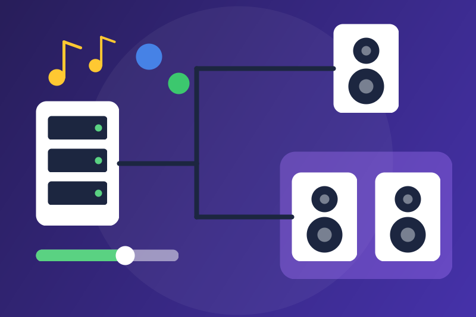

# Music Assistant for Gladys Assistant



Community integration for [Gladys Assistant](https://gladysassistant.com): the
players of your [Music Assistant](https://www.music-assistant.io/) server become
Gladys music players (browse, search, play with replace / next / append, queue,
now playing with artwork), plus scene actions: play by search (track, album,
playlist, artist, **latest album of an artist**, artist radio, radio station)
with a preferred provider (Qobuz, Spotify or automatic), volume under a cap,
group and ungroup. Qobuz, Spotify and every other provider are set up **in
Music Assistant**: this integration only talks to Music Assistant, over its
local API, with a long-lived token.

Not affiliated with the Music Assistant project. Version 0.1.0 was checked
against Music Assistant 2.10.9 with built-in providers, but was **never tested
with a real Qobuz or Spotify account** nor with real speakers.

- User guide: [English](docs/en.md) · [Français](docs/fr.md)
- Requirements: Gladys 5.3 or later, Music Assistant 2.8 or later running apart
  (Docker container in host network, or Home Assistant add-on).
- License: Apache-2.0 (see [THIRD_PARTY_NOTICES.md](THIRD_PARTY_NOTICES.md)).

## Installation en mode dev (tests de Louis)

Tant que la version 0.1.0 n'est pas publiée (pas de tag, pas de topic, donc pas
au store), trois chemins marchent d'après le code du cœur
(`server/lib/external-integration/externalIntegration.install.js`,
`ensureImage.js`, `store/store.installFromRepoUrl.js`).

### 1. Par l'image `:dev` publiée sur GHCR (le plus simple)

L'image `ghcr.io/lm1lc3n7/gladys-music-assistant:dev` (amd64 + arm64) est
construite par le workflow « Build » du dépôt, lancé à la main
(`workflow_dispatch`, entrée `image-tag` = `dev`). Elle porte le manifeste dans
son label `io.gladysassistant.manifest`.

1. Dans Gladys : **Intégrations > Installer depuis GitHub > Mode développeur :
   installer depuis une image Docker**.
2. Image Docker : `ghcr.io/lm1lc3n7/gladys-music-assistant:dev`. Laissez le
   manifeste vide : Gladys le lit dans le label de l'image.
3. Configuration : adresse de Music Assistant, jeton longue durée, puis
   **Tester la connexion** et **Découverte**.

Il faut que le paquet GHCR soit **public** : le cœur tire l'image sans
identifiants (`docker pull` par dockerode, sans `authconfig`). Pour une
nouvelle version de `:dev`, relancez le workflow puis mettez l'intégration à
jour depuis Gladys (le cœur retire l'image au moment de l'installation ou de la
mise à jour).

### 2. Par une image construite à la main, sans registre

Le mode développeur accepte une image **présente localement** quand le pull
échoue (installations dev seulement) :

```bash
# sur une machine avec le dépôt :
docker build -t gladys-music-assistant:dev \
  --build-arg GLADYS_MANIFEST="$(jq -c '.docker_image = "gladys-music-assistant:dev"' gladys-assistant-integration.json)" .
docker save gladys-music-assistant:dev | gzip > gladys-music-assistant-dev.tar.gz
# sur l'hôte de Gladys (même architecture, ou build arm64 avec buildx) :
gunzip -c gladys-music-assistant-dev.tar.gz | docker load
```

Puis même écran qu'au point 1, image `gladys-music-assistant:dev`. Un dépôt
GHCR privé passe aussi par ce chemin : `docker login ghcr.io` puis `docker pull`
sur l'hôte de Gladys, et l'installation dev retombe sur l'image locale.

### 3. Par l'URL du dépôt GitHub

**Installer depuis GitHub** avec `https://github.com/LM1LC3N7/gladys-music-assistant`
lit le manifeste de la branche par défaut (API GitHub sans authentification :
le dépôt doit être **public**, un dépôt privé répond « dépôt introuvable »),
puis tire l'image `docker_image` du manifeste, `:0.1.0`, qui n'existera qu'à la
release. Ce chemin ne marchera donc qu'après la publication ; d'ici là, prenez
le chemin 1.

### Ce que Louis doit tester avec Qobuz et Spotify

Voir `TODO.md`, section « Tests chez Louis ».

## Development

```bash
npm install
npm test
npm run lint
npm run format:check
node ~/code/ref/integration-store/src/validate-cli.js . --skip-image-check
```

Project rules: [CLAUDE.md](CLAUDE.md). Status, decisions and what is left:
[TODO.md](TODO.md).
